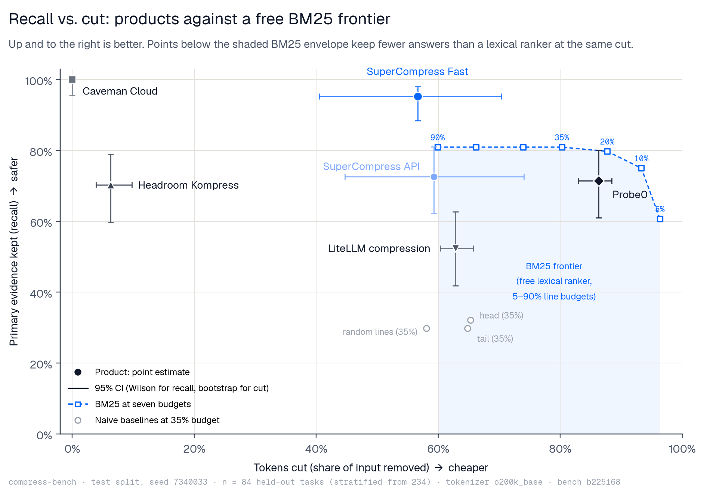
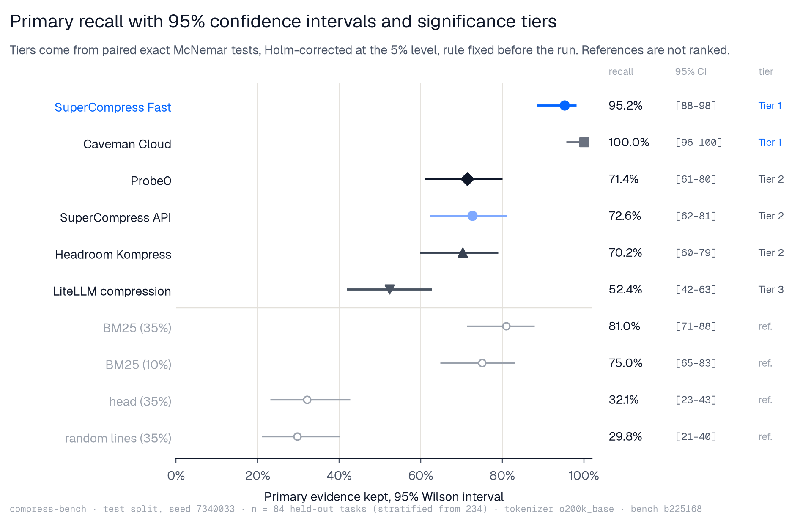
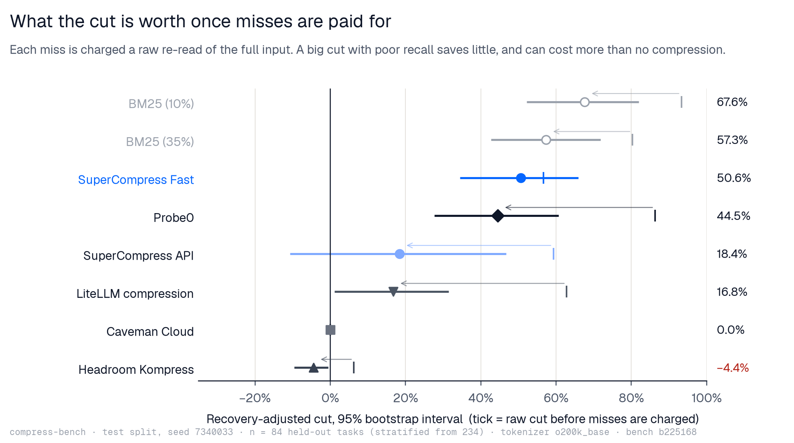
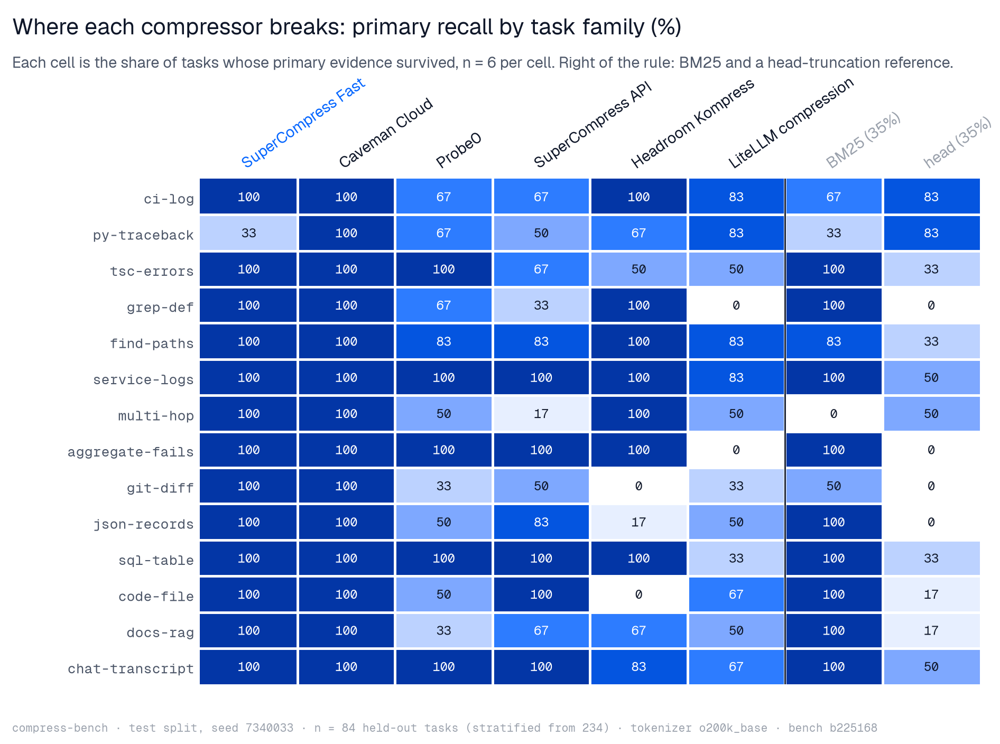
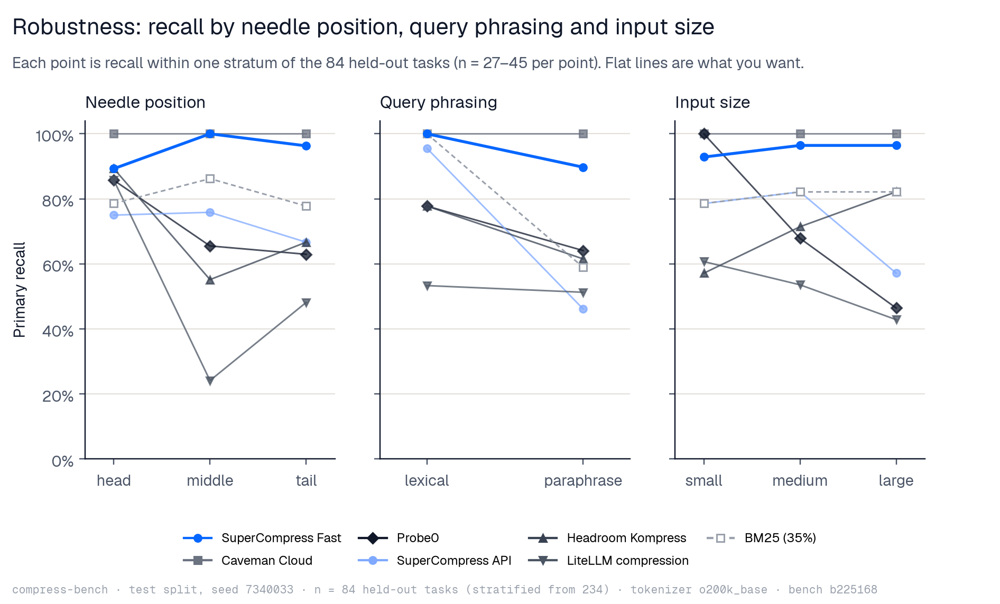
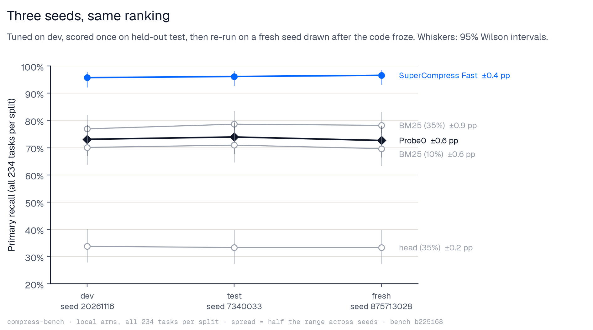
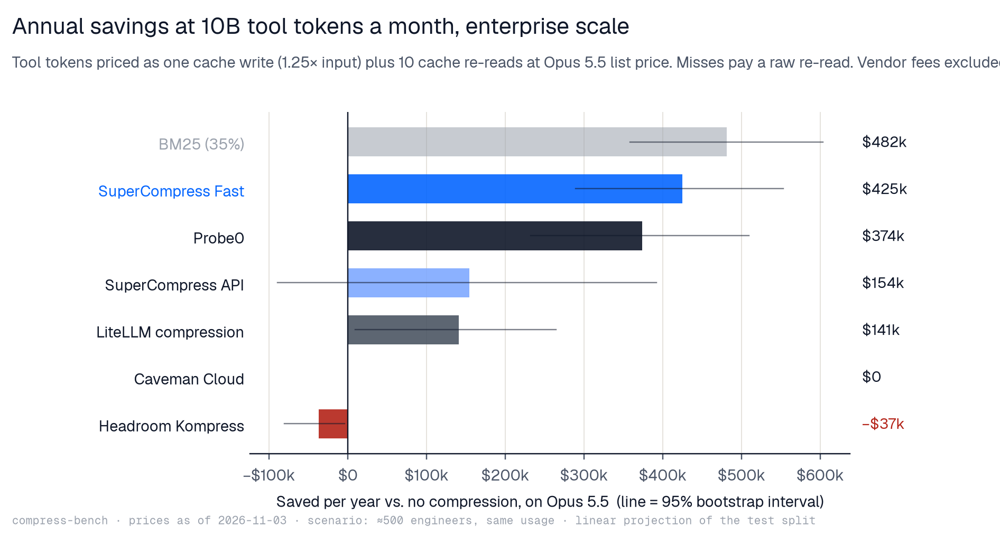
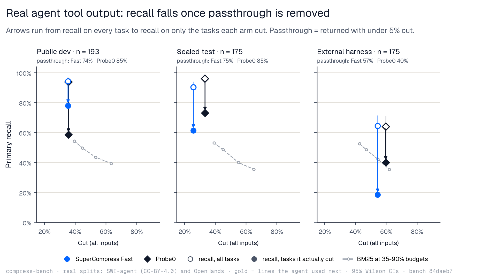

# compress-bench

A seeded, held-out benchmark for **context compressors**: tools that shrink tool output, logs,
diffs, docs and transcripts before an LLM agent reads them. It asks one question:

> After compression, is the evidence the agent needs still there, and how many tokens did it save?

It is built to be hard to game, including by us. SuperCompress wrote it, so the design leans on
controls a skeptic can check: held-out and fresh seeds, a dumb lexical baseline that every product
must beat, near-miss distractors, paired significance tests, and faithfulness checks that catch
compressors which rewrite text instead of selecting it.

**Interactive write-up:** https://supercompress.github.io/compress-bench/ walks through one task
step by step, then shows the leaderboard, the BM25 frontier, every per-task result, the cost
calculator, seed stability, every miss, and the [real-world check](#real-world-splits-anti-overfitting-protocol)
on tool output from real agent runs, where our own engine scores far lower.

## Results (held-out test split)

84 tasks, stratified over all 234 on seed `7340033`, every arm on the same task ids. The full
table, with CIs and breakdowns, is in [`results/REPORT.md`](results/REPORT.md).

| Tier | Arm | Primary recall | Cut | Recovery-adjusted cut | p50 latency |
|---|---|---|---|---|---|
| 1 | `supercompress-fast` | **95.2%** (88.4–98.1) | 56.6% | **50.6%** | 10 ms |
| 1 | `caveman-cloud` | 100% | 0.0% | 0.0% | 281 ms |
| 2 | `probe0-tool-compact` | 71.4% | 86.3% | 44.5% | 1 ms |
| 2 | `supercompress-live` | 72.6% | 59.3% | 18.4% | 39 s |
| 2 | `headroom-kompress` | 70.2% | 6.3% | −4.4% | 8.5 s |
| 3 | `litellm-compression` | 52.4% | 62.8% | 16.8% | 6 ms |
| ref | `bm25-35` | 81.0% | 80.3% | 57.3% | 1 ms |

Tiers come from exact McNemar tests with Holm correction; arms in a tier are not significantly
different. Read recall and cut together: Caveman's API takes no query and returned every input
unchanged. `supercompress-live` rejected 8 inputs over its 120k-character limit (counted as
misses). BM25 at 35% has the largest recovery-adjusted cut here, at 14 points less recall than
`supercompress-fast`.

**Seed stability.** Local arms on all 234 tasks of each split:

| Arm | dev `20261116` | test `7340033` | fresh `875713028` |
|---|---|---|---|
| `supercompress-fast` | 95.7% | 96.2% | 96.6% |
| `probe0-tool-compact` | 73.1% | 73.9% | 72.6% |
| `bm25-35` | 76.9% | 78.6% | 78.2% |

**At enterprise scale** (Opus 5.5, 100B tool tokens a month, 10 cache re-reads): `supercompress-fast`
saves about $4.25M a year, Probe0 $3.74M, the hosted API $1.54M and LiteLLM $1.41M; Headroom costs
$371k more than not compressing. See `src/pricing.js` and the calculator on the site.

```bash
git clone https://github.com/Supercompress/compress-bench && cd compress-bench
npm test                         # 39 unit/integration tests, offline
node src/cli.js --list           # which arms are runnable on this machine, and why not
node src/cli.js --split dev      # local arms on the dev split  -> results/REPORT.md
node src/cli.js --split test --sample 2   # held-out split; remote arms on a stratified sample
node src/cli.js --split fresh    # brand-new seed from the clock (recorded in the report)
```

Node ≥ 20, no dependencies. `js-tiktoken` (o200k_base) is used when resolvable from
`node_modules` or `$BENCH_DEPS/node_modules`; otherwise a chars/4 estimate is used and the report
says so.

## Figures

Publication-ready figures live in [`figures/out/`](figures/out/) as SVG, PDF and 2× PNG. Each one states its sample size, interval method and bench commit. Rebuild them from the site data with `python3 figures/make_figures.py`, which needs matplotlib. The Geist fonts (OFL) are in `figures/fonts/`.



| | |
|---|---|
|  |  |
|  |  |
|  |  |



## Real-world splits (anti-overfitting protocol)

The synthetic splits change the seed, not the generator code. A compressor developed against
these generators can learn their templates, and dev, test and fresh seeds will all agree with it.
The real splits close that gap: nothing in them is written by us.

| Split | Source | Who may look | Tasks |
|---|---|---|---:|
| `real-dev` | [nebius/SWE-agent-trajectories](https://huggingface.co/datasets/nebius/SWE-agent-trajectories) (CC-BY-4.0) | Anyone. Tune on it. Shipped in `data/real/dev.jsonl.gz`. | 193 |
| `real-test` | Same source, other issues | Nobody by policy. Membership is `sha256(salt + instance_id)`, and `sha256(salt)` was published before any tuning (`data/real/MANIFEST.json`). That proves the split was fixed in advance. It does not hide the data: the source is public, so treat this split as an honesty check, not a vault. | 175 |
| `real-external` | OpenHands trajectories (a different agent harness, different tool formats) | Nobody. Never tuned on. Local only, not redistributed. This is the real generalisation check: rules that only fit SWE-agent's output formats fail here. | 175 |

**Task construction** (`scripts/build_real_split.py`, deterministic, no LLM labels):
- **Observation:** one tool output the agent received.
- **Query:** the agent's own reasoning and command just before it ran the tool.
- **Golds:** the observation lines that hold a distinctive token which appears in this observation for the first time in the session and that the agent uses in its very next message. Lines whose token reaches the agent's next *command* are primary.
- One task per issue per family, so tasks stay independent.

**Rules we hold ourselves to.** Tune only on `dev` and `real-dev`. Score `test`, `real-test` and
`real-external` once per engine version and publish whatever comes out. Read recall together with
**abstention**, the share of inputs returned with under a 5% cut, and with **recall when it
compressed**. Passing input through always keeps the answer, so recall alone rewards doing nothing.

```
node src/cli.js --split real-dev        # public
node src/cli.js --split real-test       # needs the sealed file (maintainers until reveal)
```

### Real-world results

Same 35% budget, local arms on every task. Read the passthrough column first.

| Split | Arm | Primary recall | Passthrough | Recall when it compressed | Cut | Recovery-adjusted cut |
|---|---|---|---:|---|---:|---:|
| `real-dev` | `supercompress-fast` | 94.3% (90–97) | 74.1% | 78.0% (n=50) | 35.4% | 12.8% |
| `real-dev` | `probe0-tool-compact` | 93.8% (89–96) | 85.0% | 58.6% (n=29) | 35.7% | 9.1% |
| `real-dev` | `bm25-50` | 43.5% (37–51) | 0.0% | 43.5% (n=193) | 53.3% | −15.5% |
| `real-dev` | `truncate-tail-35` | 33.2% (27–40) | 0.0% | 33.2% (n=193) | 65.8% | 8.1% |
| `real-test` | `supercompress-fast` | 90.3% (85–94) | 74.9% | 61.4% (n=44) | 25.7% | 15.8% |
| `real-test` | `probe0-tool-compact` | 96.0% (92–98) | 85.1% | 73.1% (n=26) | 33.3% | 15.5% |
| `real-test` | `bm25-50` | 40.0% (33–47) | 0.0% | 40.0% (n=175) | 55.0% | −14.1% |
| `real-test` | `truncate-tail-35` | 36.6% (30–44) | 0.0% | 36.6% (n=175) | 66.0% | 7.8% |
| `real-external` | `supercompress-fast` | 64.6% (57–71) | 56.6% | 18.4% (n=76) | 54.4% | 3.9% |
| `real-external` | `probe0-tool-compact` | 64.0% (57–71) | 40.0% | 40.0% (n=105) | 59.7% | 3.2% |
| `real-external` | `bm25-50` | 42.3% (35–50) | 0.0% | 42.3% (n=175) | 54.5% | −16.7% |
| `real-external` | `truncate-tail-35` | 38.9% (32–46) | 0.0% | 38.9% (n=175) | 66.0% | −8.9% |

What this shows, including where it hurts us:

- **We now rank first on every split, but the real-world leads are within noise.** On sealed real-test our recovery-adjusted cut is 15.8% against Probe0's 15.5%; on OpenHands it is 3.9% against 3.2%. Both arms share tier 1 on all three real splits.
- **Much of the recall gain is passthrough.** This engine version leaves inputs under about 1k tokens alone, so it returns 74–75% of SWE-agent outputs unchanged (Probe0: 85%). Read the recall column next to that.
- **Probe0 still keeps more when it does cut.** On sealed real-test it keeps the answer on 73.1% of the inputs it compresses against our 61.4%; on OpenHands 40.0% against our 18.4%.
- **The synthetic score does not transfer.** `supercompress-fast` keeps 92% of answers on synthetic tasks it cuts, 78% on real-dev, 61% on sealed real-test and 18% on OpenHands.
- **Nobody generalises across harnesses yet.** On OpenHands both products sit near or below the BM25 line once passthrough is removed. That split is the number a compressor has to win.

#### Engine versions

Each version is scored once on the held-out splits; earlier scores stay listed.

| Version | Change | real-test recall · when compressed · RAC | real-external recall · when compressed · RAC | synthetic test recall |
|---|---|---|---|---|
| v1 | Structure-aware pass (test verdicts, search-hit lists, enclosing code blocks), developed on real-dev | 68.6% · 48.1% · 13.4% | 57.7% · 26.7% · 2.6% | 96.2% |
| v2 | Agent tool output rules (inputs under ~1k tokens pass through, every search hit kept, head/tail tool status lines, test failure and summary lines, code window around `goto`/`open` targets), developed on real-dev and synthetic dev | 90.3% · 61.4% · 15.8% | 64.6% · 18.4% · 3.9% | 96.2% |

RAC = recovery-adjusted cut. Before v1, recall when compressed was 29.0% on sealed real-test and 21.8% on real-external. v2 synthetic numbers come from a rerun of the local arms (`supercompress-live` and the worker arms in the leaderboard above were not rerun).

Sealed splits (`real-test`, `real-external`) are published as scores only: `results-real-*/` replace task ids with hashes and drop gold text.


## Corpus

14 task families × 3 sizes (≈0.6k–56k tokens) × 3 needle positions (head / middle / tail) ×
up to 2 query styles = **234 tasks per split** (`--reps N` multiplies it).

| Family | What a compressor has to get right |
|---|---|
| `ci-log` | One Jest FAIL block among hundreds of PASS lines; a `-legacy` suite that passed on retry is the near miss; a big coverage table sits at the tail. |
| `py-traceback` | The *innermost app frame* of a fatal traceback buried under library frames; a handled `KeyError` traceback is the near miss. |
| `tsc-errors` | One TS2345 error inside hundreds of warnings, many from the same file. |
| `grep-def` | `rg` output where every line contains the symbol; only one is the definition; a `…Mock` with the same prefix is the near miss. |
| `find-paths` | A path whose siblings differ by one segment (`staging/` vs `prod/`, another region). Paraphrase queries name the city, not the region code. |
| `service-logs` | One ERROR with a request id; WARN lines carry ids that differ in the last character. |
| `multi-hop` | The error names a session id; a different, earlier line maps that session to the user's email. Both hops must survive. |
| `aggregate-fails` | "List every failing test": 4–9 failures scattered through a pytest run. All must survive. |
| `git-diff` | A `-`/`+` pair in one hunk of a multi-file diff; other hunks change similar keys. |
| `json-records` | Pretty-printed JSON: the answer needs the id line *and* sibling fields of the same object. Near-miss id differs in one character. |
| `sql-table` | psql output; account ids differ by a digit transposition. |
| `code-file` | A constant inside the current function; a `…Legacy` twin holds a different value. |
| `docs-rag` | Product docs; paraphrase queries share almost no words with the gold sentence ("How long can a login sit unused…" → "Idle sessions are revoked after 37 minutes"). |
| `chat-transcript` | A decision made once in a long transcript; a rejected alternative appears later. |

Every task carries:

- `golds`: exact evidence strings. The generator guarantees each one occurs **exactly once** in the input.
- `primary`: the subset that *is* the answer (for `aggregate-fails`, all of them).
- `distractors`: near-miss look-alikes that are present and never contain a gold.

A task that breaks any of these rules is regenerated (`attempt` is recorded). The query never
contains the primary answer, and paraphrase queries are tested to avoid the gold's ids and numbers. All of this is enforced in `test/corpus.test.js` across many seeds.

### Splits and seeds

| Split | Seed | Use |
|---|---|---|
| `dev` | 20261116 | Look at it, debug against it. |
| `test` | 7340033 | Published numbers. Shares no task text with `dev` (tested). |
| `fresh` | from the clock | Re-run at any time to check nobody overfit the fixed seeds. The seed goes into the report, so a fresh run can be reproduced exactly with `--seed`. |

The generators are public, so a vendor *could* tune to their shapes. The `fresh` split and the
`--reps` option are the counter: same distributions, different instances. If a product scores far
better on `test` than on `fresh`, that is overfitting.

## Arms

| Arm | Type | Notes |
|---|---|---|
| `raw` | reference | No compression. Recall ceiling. |
| `truncate-head-35`, `truncate-tail-35` | reference | Naive `head`/`tail` at the same budget. |
| `random-lines-35` | reference | Seeded random lines, in order. The chance floor. |
| `bm25-{5..90}` | reference | BM25 line ranking against the query at 7 budgets. The **frontier**. |
| `supercompress-fast` | local | SuperCompress Fast engine in-process (`SC_ROOT`). |
| `supercompress-live` | remote | Hosted SuperCompress API. |
| `probe0-tool-compact` | local | Port of Probe0 CLI 0.1.19 tool-output compaction (`PROBE0_COMPACT_PATH`). |
| `caveman-cloud` | remote | Caveman Cloud `/sdk/v1/compress`. Its contract has no query field, so it never sees the question. |
| `headroom-kompress` | worker | Headroom Kompress ONNX model, offline (`HEADROOM_PYTHON`). |
| `litellm-compression` | worker | `litellm.compression.compress` (`LITELLM_PYTHON`). |

All arms are given the same text and, if their API accepts one, the same query. Budget-taking arms
get the same ratio (`--ratio`, default 0.35). An arm whose prerequisites are missing is listed as
skipped with the reason; nothing is mocked.

Remote and worker outputs are cached in `results/cache/` keyed by task id, text hash and query
hash. An interrupted run resumes without re-billing. Errors are never cached.

## Metrics

Containment is checked on normalized text (lower case, collapsed whitespace). Re-indenting is
fine. Rewriting, abbreviating or paraphrasing the evidence counts as losing it.

| Metric | Definition |
|---|---|
| **Primary recall** | Share of tasks where every `primary` string survives. Wilson 95% CI. |
| All-gold recall | Share of tasks where every gold survives. |
| **Cut** | Token-weighted `1 − Σout / Σin`. Percentile-bootstrap 95% CI (2,000 resamples, seeded). |
| **Recovery-adjusted cut** | `1 − Σ(out + in·[primary lost]) / Σin`. When compression loses the answer, the agent re-reads the raw output, so a miss costs the full input on top of what was sent. This puts savings and lost evidence in the same unit: tokens. It can go negative. |
| vs BM25 @ same cut | Primary recall minus the BM25 frontier's recall at the arm's own cut (linear interpolation). Positive = the product beats a 20-line lexical ranker at equal compression. |
| Fidelity | Share of non-marker output lines that occur verbatim in the input. Below 100% means the compressor wrote text that was not there. |
| Out-of-order | Tasks where kept lines appear in a different order from the source (repeated lines handled). |
| Untouched / expanded | Tasks returned at ≥ input size / larger than input. |
| Distractors kept | Mean near-miss strings retained per task (diagnostic only). |
| Latency | p50 / p95 wall-clock per call, cached calls report their original time. |
| Determinism | Local arms are run twice; outputs must be byte-identical. |

Errors (timeouts, HTTP failures) count as **misses with zero savings**. They are never treated as
pass-through wins.

## Cost model

Compression only changes **input** tokens, so the report prices input only, using Anthropic API
list prices (snapshot 2026-11-03, `src/pricing.js`; override with `--prices file.json`):

| Model | Input $/1M | Cache read $/1M |
|---|---:|---:|
| Fable 5.2 | 8.00 | 0.20 |
| Opus 5.5 | 4.00 | 0.20 |
| Sonnet 5.5 | 2.00 | 0.10 |
| Haiku 5.5 | 0.10 | 0.01 (assumed 0.1× input) |

A tool result enters the agent's context once (cache write, 1.25× input) and is re-read from
cache on each later turn (`--rereads`, default 10). Cost uses the **recovery-adjusted** cut, so a
compressor that loses answers pays for the raw re-reads it causes. Vendor fees for the compressor
itself are not included.

The report projects monthly cost and savings at three scales of tool-output tokens entering
agent context:

| Scenario | Tokens / month | Rough shape |
|---|---:|---|
| Team (1x) | 1B | ≈50 engineers × 20 sessions/day × 50k tool tokens × 21 days |
| Enterprise (10x) | 10B | ≈500 engineers |
| Enterprise (100x) | 100B | ≈5,000 engineers, or heavy autonomous agents |

Projections scale the measured recall and cut linearly. `npm run report -- results --rereads 20`
re-renders the report with a different session length without re-running anything.

## Ranking rule

Fixed before any run:

1. **Correctness tiers.** Take the arm with the highest primary recall. Every other arm is
   compared with it using an exact McNemar test on paired task outcomes, with Holm correction. Arms
   that are not significantly worse join tier 1. Remove tier 1 and repeat for tier 2, and so on.
2. **Within a tier**, order by recovery-adjusted cut.

Reference baselines are reported but not ranked. When remote arms run on a sample, **every arm is
scored on the same task ids** (the intersection), so no arm benefits from an easier subset.
Full-corpus numbers for local arms are still in `results.json` (`full_corpus`).

## Outputs

- `results/REPORT.md`: leaderboard, per-family, per-position, per-size and per-query-style
  breakdowns, faithfulness, BM25 frontier, pairwise tests, and a sample of misses per product.
- `results/results.json`: every per-task row for every arm, plus provenance (file hashes, API
  hosts, worker versions), seed, tokenizer and corpus fingerprint.
- `--save-outputs` also writes every compressed text to `results/outputs/` for audit.

## Threats to validity

- **Synthetic data.** Tasks are generated, not sampled from real agent sessions. They imitate the
  shapes that dominate coding-agent context (CI, logs, grep, diffs, JSON, SQL, docs), but real
  distributions differ. Treat this as a controlled stress test, not a traffic replay.
- **Containment is a proxy.** Keeping the evidence string is necessary for a correct answer but not
  sufficient. A compressor could keep the gold and still mislead with what it drops. Downstream QA
  with an LLM reader is the natural next layer and is not included yet.
- **Exact-string scoring penalizes abstractive compressors.** Tools that summarize or delete
  tokens (for example token-level pruning) can preserve meaning but fail containment. Fidelity and
  all-gold recall make this visible rather than hiding it.
- **Author bias.** SuperCompress wrote this benchmark. The controls above (held-out and fresh
  seeds, BM25 frontier, paired tests, published per-task rows) exist so you don't have to trust us.
  Re-run it on `--split fresh` and check.
- **Vendor contracts differ.** Caveman Cloud's API takes no query. Probe0 is a port of its CLI
  logic, not its hosted product. The hosted SuperCompress API may apply policies the local engine
  does not.
- **Latency** is measured from one machine on one network and includes remote round trips.

## Running the product arms

Reference arms run anywhere. Product arms need their own access, and are skipped with a reason
when it is missing (`node src/cli.js --list`):

- `supercompress-fast` and `probe0-tool-compact` load JavaScript from a SuperCompress checkout:
  set `SC_ROOT`. The files are not vendored here; the report records the path and a sha256 prefix
  of the exact file that ran (`fast-compress.js` `48b1b7b11ee4e1bb`, `probe0_tool_compact.js`
  `630e4300feca6f15` for the published results).
- `supercompress-live` needs a SuperCompress API key; `caveman-cloud` needs `CAVE_API_KEY`.
- `headroom-kompress` and `litellm-compression` need a Python with the package installed
  (`HEADROOM_PYTHON`, `LITELLM_PYTHON`).

## The site

`site/` is a Vite + React app, deployed to GitHub Pages by `.github/workflows/pages.yml`. It reads
one file, `site/src/data/bench.json`, built from the three results folders:

```bash
node site/scripts/build-data.cjs     # results*/ -> site/src/data/bench.json
cd site && pnpm install && pnpm dev
```

It uses dithercn for the hero field and dithered fills,
asciicn for the terminals, gradients.sh for the cost
section, a vendored copy of [ditherkit](https://github.com/jvgomg/ditherkit) (MIT) for the
illustrations, and GSAP + Lenis for the guided scroll.

## Layout

```
src/
  cli.js          argument parsing, orchestration, results.json + REPORT.md
  corpus.js       split seeds, task grid, validation contract, stratified sampling
  families/*.js   one generator per task family
  arms/           baselines.js (raw/truncate/random/BM25), products.js (real products)
  runner.js       per-arm execution, caching, determinism pass
  scoring.js      per-task containment, fidelity, ordering
  aggregate.js    summaries, bootstrap CIs, tiers, BM25 frontier lift
  stats.js        Wilson, bootstrap, exact McNemar, Holm
  report.js       Markdown renderer
workers/          JSON-lines Python workers for Headroom and LiteLLM
results*/         published runs: test (all arms), dev and fresh (local arms)
site/             the GitHub Pages write-up
test/             node:test suite
```
